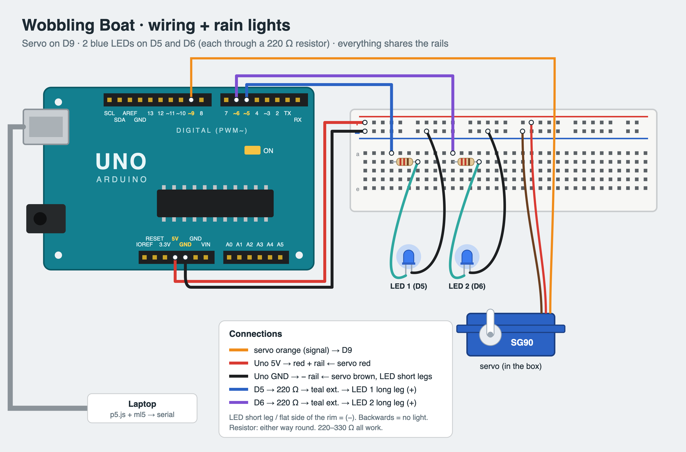

# Wave → Boat

Hand-tracking controller for a kinetic wobbling-boat sculpture.
Wave your hand at the laptop camera: **faster waving builds a storm**, **wider waving raises the wind**.
The page animates the weather over the camera feed and drives a servo (the boat) and two blue "rain" LEDs on an Arduino Uno over Web Serial.

| You do | Boat (servo) | Screen | LEDs |
|---|---|---|---|
| Wave faster | rocks faster (rate 0.2–1.5 Hz) | fog → rain → lightning | glow once it rains, brighter in a downpour |
| Wave wider | rocks further (±0–35°) | wind streaks, slanted rain, flying leaves | — |
| Fist / hand away | eases back to center | weather clears | fade off |

Built with [MediaPipe Gesture Recognizer](https://ai.google.dev/edge/mediapipe/solutions/vision/gesture_recognizer) (hand landmarks) and the Web Serial API.

## Run

1. Wire the Uno as in `docs/wiring.png` (servo signal → D9, LEDs → 220 Ω → D5 / D6).
2. Upload `arduino/boat_simple/boat_simple.ino`. Set `CENTER` to the servo angle where your mechanism sits level (type angles in the Serial Monitor to find it).
3. Close the Serial Monitor, then serve this folder:
   ```bash
   python3 -m http.server 8000
   ```
4. Open http://localhost:8000 in **Chrome or Edge** (Web Serial is not in Safari/Firefox).
5. **Start camera** → **Connect Arduino** → pick the Uno's port → wave.

## Serial protocol

The page sends one line ~10× per second at 9600 baud:

```
amp,freq,rain\n      e.g.  24.5,1.10,0.62
```

- `amp`  servo swing, 0–35° either side of `CENTER`
- `freq` rocking rate, 0.1–1.5 Hz
- `rain` 0–1, LED brightness

No message for 3 s → the boat settles at `CENTER` and the LEDs fade off.

## How the wave is measured

Hand tilt = angle of the wrist → middle-knuckle line. Turn-around points (with a 5° dead band) give
**speed** = half-swings ÷ time and **angle** = mean peak-to-peak ÷ 2. Tune → sliders set what counts as a full-speed / full-width wave.


